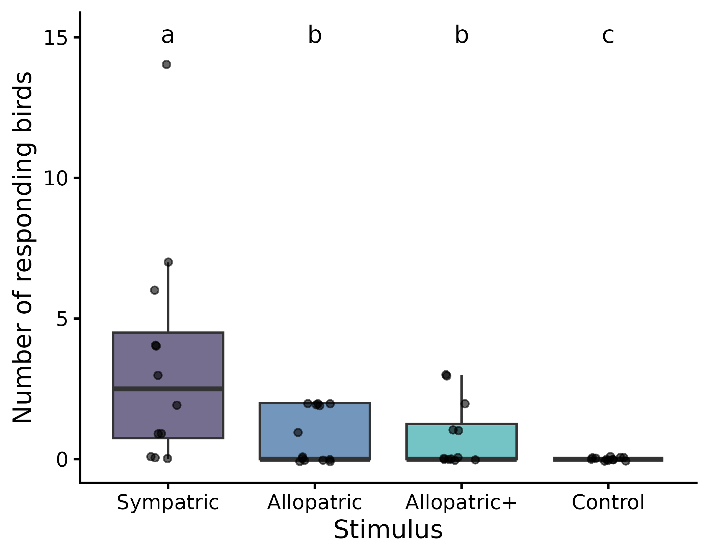
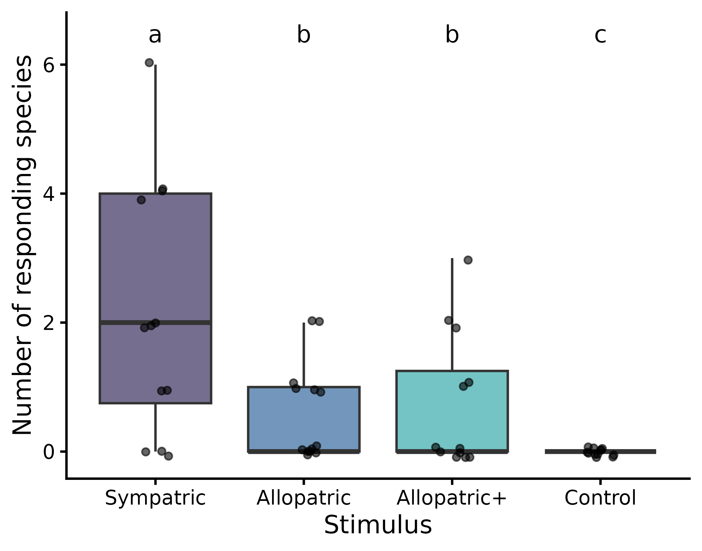

This site contains the analyses behind the manuscript (under review). We broadcast calls of three closely related pygmy-owls at Las Cruces Biological Station, Costa Rica, to test whether acoustic predator recognition in passerine birds depends on local coexistence with the predator: *Glaucidium costaricanum* (sympatric), *G. brasilianum* (allopatric, with range overlap elsewhere) and *G. passerinum* (strictly allopatric), plus the song of a non-predatory warbler, *Basileuterus delattrii*, as control. We counted the birds and species that responded in 49 playback trials at 31 sites (2024 and 2026).

## Analysis reports

- **[Statistical analysis](scripts/1_statistical_analysis.qmd)**: sampling design, Bayesian mixed models of the number of responding birds and species (stimulus and year as fixed effects, site as random effect), Poisson vs. negative binomial comparison, prior sensitivity, MCMC diagnostics and pairwise contrasts (Tables 1–2, Figs. 3–4, Supplementary materials 2–4)
- **[Preliminary analysis (2024)](scripts/mobbing_ontogeny.qmd)**: predictions, data exploration and the first models fitted during the field course (in Spanish)

## Main results

::: {.figure-gallery}

:::

Birds responded about three to five times more to the sympatric owl than to either allopatric owl, responded similarly to both allopatric owls, and never responded to the control.

## Reproducibility

All code and data are available in the [GitHub repository](https://github.com/maRce10/mobbing_ontogeny). Fitted models are cached in `data/processed/models/` (not hosted on GitHub because of their size; they are refitted by the analysis report).
