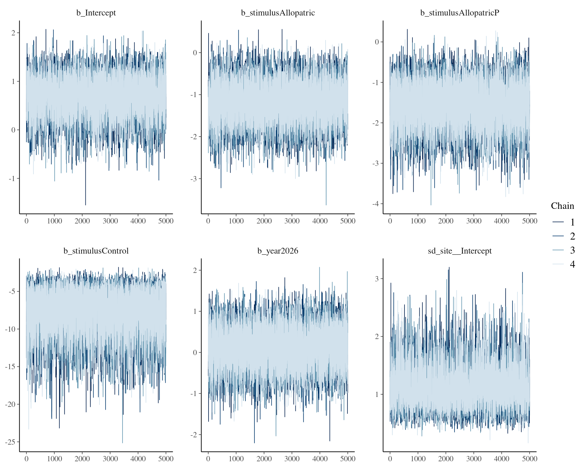
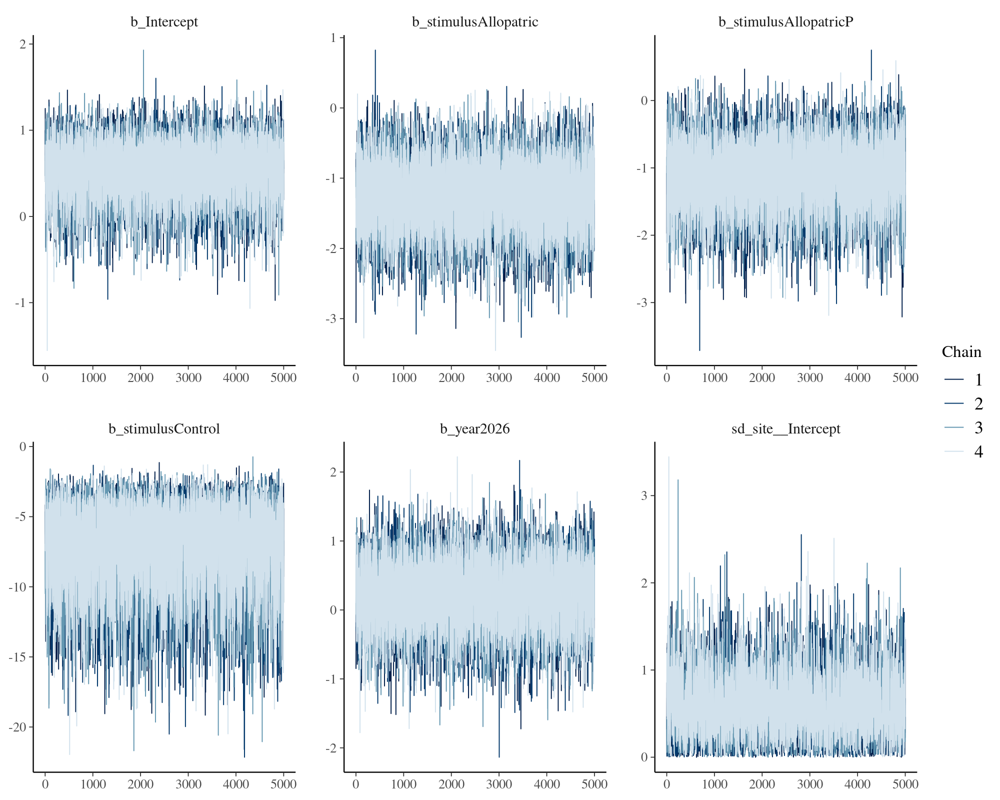
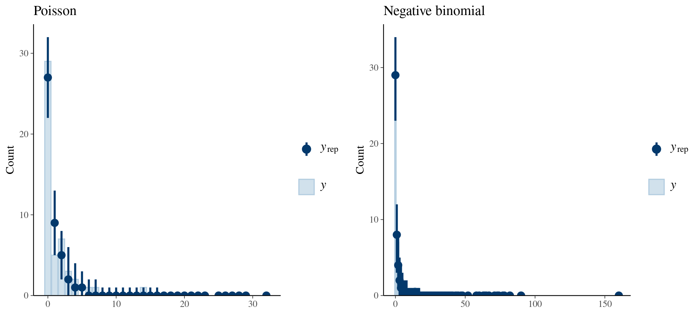
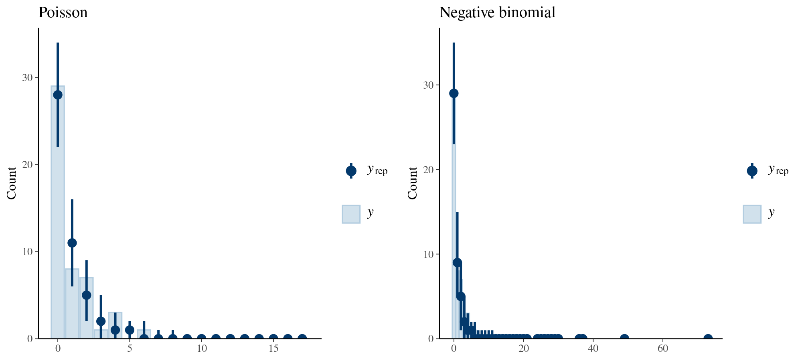

# Supplementary material 2

Number of playback trials per stimulus, year and exemplar (recording of a different individual). All 2024 trials used exemplar 1.

| Stimulus | 2024 (exemplar 1) | 2026 (exemplar 2) | 2026 (exemplar 3) | Total |
|---|---|---|---|---|
| Sympatric (G. costaricanum) | 10 | 1 | 1 | 12 |
| Allopatric (G. brasilianum) | 11 | 1 | 1 | 13 |
| Allopatric+ (G. passerinum) | 10 | 1 | 1 | 12 |
| Control (B. delattrii) | 10 | 1 | 1 | 12 |

Sites received one (21 sites), two (6 sites) or four (4 sites) trials, always on different days (49 trials at 31 sites).

# Supplementary material 3

**Table S3.1.** Parameter estimates of the Poisson model of the number of responding birds (stimulus and year as fixed effects, site as random intercept; reference levels: sympatric stimulus, 2024).

| Parameter | Estimate | l-95% CrI | u-95% CrI | R-hat | Bulk ESS | Tail ESS |
|---|---|---|---|---|---|---|
| Intercept | 0.714 | -0.114 | 1.404 | 1.000 | 9170 | 14192 |
| stimulusAllopatric | -1.172 | -2.099 | -0.300 | 1.000 | 13758 | 14744 |
| stimulusAllopatricP | -1.568 | -2.670 | -0.598 | 1.000 | 10748 | 12393 |
| stimulusControl | -7.789 | -14.776 | -3.485 | 1.000 | 11351 | 9265 |
| year2026 | 0.114 | -0.852 | 1.046 | 1.000 | 13376 | 14500 |
| sd(Intercept) | 1.120 | 0.579 | 1.925 | 1.001 | 6430 | 10699 |

**Table S3.2.** Parameter estimates of the negative binomial model of the number of responding birds (stimulus and year as fixed effects, site as random intercept; reference levels: sympatric stimulus, 2024).

| Parameter | Estimate | l-95% CrI | u-95% CrI | R-hat | Bulk ESS | Tail ESS |
|---|---|---|---|---|---|---|
| Intercept | 1.065 | 0.149 | 2.006 | 1.000 | 10403 | 12750 |
| stimulusAllopatric | -1.311 | -2.539 | -0.118 | 1.000 | 19298 | 14573 |
| stimulusAllopatricP | -1.453 | -2.749 | -0.194 | 1.000 | 19200 | 14352 |
| stimulusControl | -7.877 | -15.037 | -3.360 | 1.000 | 14876 | 10306 |
| year2026 | 0.120 | -1.243 | 1.501 | 1.001 | 23021 | 14157 |
| sd(Intercept) | 0.587 | 0.025 | 1.555 | 1.001 | 4231 | 8728 |

**Table S3.3.** Parameter estimates of the Poisson model of the number of responding species and morphospecies (stimulus and year as fixed effects, site as random intercept; reference levels: sympatric stimulus, 2024).

| Parameter | Estimate | l-95% CrI | u-95% CrI | R-hat | Bulk ESS | Tail ESS |
|---|---|---|---|---|---|---|
| Intercept | 0.545 | -0.125 | 1.083 | 1.000 | 14706 | 14377 |
| stimulusAllopatric | -1.256 | -2.183 | -0.382 | 1.000 | 18513 | 14800 |
| stimulusAllopatricP | -1.131 | -2.118 | -0.249 | 1.000 | 15990 | 12830 |
| stimulusControl | -7.350 | -14.353 | -2.949 | 1.000 | 11068 | 9378 |
| year2026 | 0.219 | -0.736 | 1.082 | 1.000 | 17292 | 13639 |
| sd(Intercept) | 0.572 | 0.039 | 1.321 | 1.001 | 4220 | 6849 |

**Table S3.4.** Parameter estimates of the negative binomial model of the number of responding species and morphospecies (stimulus and year as fixed effects, site as random intercept; reference levels: sympatric stimulus, 2024).

| Parameter | Estimate | l-95% CrI | u-95% CrI | R-hat | Bulk ESS | Tail ESS |
|---|---|---|---|---|---|---|
| Intercept | 0.633 | -0.080 | 1.353 | 1.000 | 14865 | 15372 |
| stimulusAllopatric | -1.262 | -2.335 | -0.249 | 1.000 | 21142 | 14639 |
| stimulusAllopatricP | -1.100 | -2.195 | -0.047 | 1.000 | 17286 | 13659 |
| stimulusControl | -7.281 | -14.231 | -2.958 | 1.000 | 10653 | 9500 |
| year2026 | 0.148 | -1.018 | 1.238 | 1.000 | 19698 | 13897 |
| sd(Intercept) | 0.437 | 0.017 | 1.203 | 1.001 | 5159 | 8463 |

**Table S3.5.** Pairwise contrasts (log scale) for the number of responding birds: Poisson model, normal(0, 2) priors.

| Contrast | Estimate | 95% HPD lower | 95% HPD upper |
|---|---|---|---|
| Sympatric - Allopatric | 1.066 | 0.239 | 1.957 |
| Sympatric - (Allopatric+) | 1.367 | 0.481 | 2.408 |
| Sympatric - Control | 4.053 | 2.216 | 6.233 |
| Allopatric - (Allopatric+) | 0.304 | -0.803 | 1.430 |
| Allopatric - Control | 3.005 | 1.090 | 5.419 |
| (Allopatric+) - Control | 2.687 | 0.811 | 5.066 |

**Table S3.6.** Pairwise contrasts (log scale) for the number of responding birds: Poisson model, normal(0, 6) priors (main text).

| Contrast | Estimate | 95% HPD lower | 95% HPD upper |
|---|---|---|---|
| Sympatric - Allopatric | 1.167 | 0.258 | 2.054 |
| Sympatric - (Allopatric+) | 1.549 | 0.535 | 2.597 |
| Sympatric - Control | 7.299 | 3.033 | 13.801 |
| Allopatric - (Allopatric+) | 0.381 | -0.738 | 1.631 |
| Allopatric - Control | 6.129 | 1.693 | 12.596 |
| (Allopatric+) - Control | 5.731 | 1.293 | 12.202 |

**Table S3.7.** Pairwise contrasts (log scale) for the number of responding birds: Poisson model, normal(0, 10) priors.

| Contrast | Estimate | 95% HPD lower | 95% HPD upper |
|---|---|---|---|
| Sympatric - Allopatric | 1.179 | 0.273 | 2.058 |
| Sympatric - (Allopatric+) | 1.557 | 0.571 | 2.678 |
| Sympatric - Control | 9.432 | 3.173 | 18.779 |
| Allopatric - (Allopatric+) | 0.374 | -0.799 | 1.621 |
| Allopatric - Control | 8.237 | 1.867 | 17.549 |
| (Allopatric+) - Control | 7.872 | 1.691 | 17.411 |

**Table S3.8.** Pairwise contrasts (log scale) for the number of responding birds: negative binomial model, normal(0, 6) priors.

| Contrast | Estimate | 95% HPD lower | 95% HPD upper |
|---|---|---|---|
| Sympatric - Allopatric | 1.312 | 0.093 | 2.507 |
| Sympatric - (Allopatric+) | 1.441 | 0.173 | 2.726 |
| Sympatric - Control | 7.369 | 2.887 | 14.074 |
| Allopatric - (Allopatric+) | 0.142 | -1.258 | 1.517 |
| Allopatric - Control | 6.073 | 1.542 | 12.831 |
| (Allopatric+) - Control | 5.924 | 1.284 | 12.630 |

**Table S3.9.** Pairwise contrasts (log scale) for the number of responding species and morphospecies: Poisson model, normal(0, 2) priors.

| Contrast | Estimate | 95% HPD lower | 95% HPD upper |
|---|---|---|---|
| Sympatric - Allopatric | 1.146 | 0.273 | 2.008 |
| Sympatric - (Allopatric+) | 1.005 | 0.163 | 1.913 |
| Sympatric - Control | 3.675 | 1.785 | 5.868 |
| Allopatric - (Allopatric+) | -0.140 | -1.184 | 0.917 |
| Allopatric - Control | 2.527 | 0.560 | 4.840 |
| (Allopatric+) - Control | 2.665 | 0.613 | 4.894 |

**Table S3.10.** Pairwise contrasts (log scale) for the number of responding species and morphospecies: Poisson model, normal(0, 6) priors (main text).

| Contrast | Estimate | 95% HPD lower | 95% HPD upper |
|---|---|---|---|
| Sympatric - Allopatric | 1.244 | 0.359 | 2.156 |
| Sympatric - (Allopatric+) | 1.116 | 0.223 | 2.084 |
| Sympatric - Control | 6.848 | 2.302 | 13.165 |
| Allopatric - (Allopatric+) | -0.126 | -1.253 | 0.958 |
| Allopatric - Control | 5.602 | 0.975 | 11.980 |
| (Allopatric+) - Control | 5.704 | 1.376 | 12.343 |

**Table S3.11.** Pairwise contrasts (log scale) for the number of responding species and morphospecies: Poisson model, normal(0, 10) priors.

| Contrast | Estimate | 95% HPD lower | 95% HPD upper |
|---|---|---|---|
| Sympatric - Allopatric | 1.262 | 0.382 | 2.198 |
| Sympatric - (Allopatric+) | 1.132 | 0.255 | 2.115 |
| Sympatric - Control | 8.967 | 2.444 | 18.384 |
| Allopatric - (Allopatric+) | -0.129 | -1.237 | 0.972 |
| Allopatric - Control | 7.696 | 1.181 | 17.315 |
| (Allopatric+) - Control | 7.805 | 1.360 | 17.470 |

**Table S3.12.** Pairwise contrasts (log scale) for the number of responding species and morphospecies: negative binomial model, normal(0, 6) priors.

| Contrast | Estimate | 95% HPD lower | 95% HPD upper |
|---|---|---|---|
| Sympatric - Allopatric | 1.250 | 0.272 | 2.350 |
| Sympatric - (Allopatric+) | 1.094 | 0.047 | 2.195 |
| Sympatric - Control | 6.804 | 2.457 | 13.084 |
| Allopatric - (Allopatric+) | -0.165 | -1.359 | 1.093 |
| Allopatric - Control | 5.533 | 1.080 | 11.913 |
| (Allopatric+) - Control | 5.697 | 1.368 | 12.202 |

# Supplementary material 4

{width=6in}

{width=6in}

{width=6in}

{width=6in}

