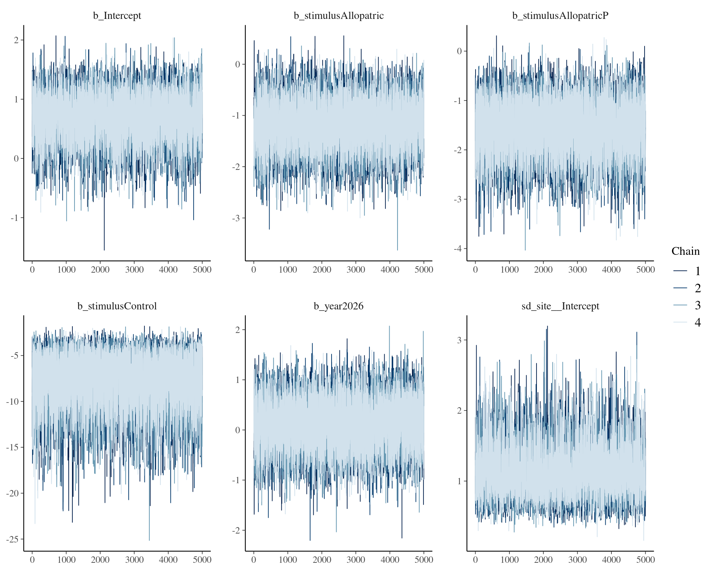
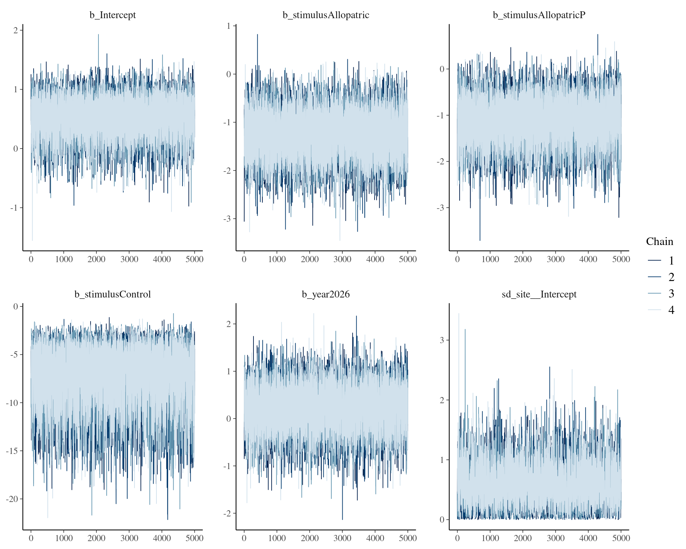
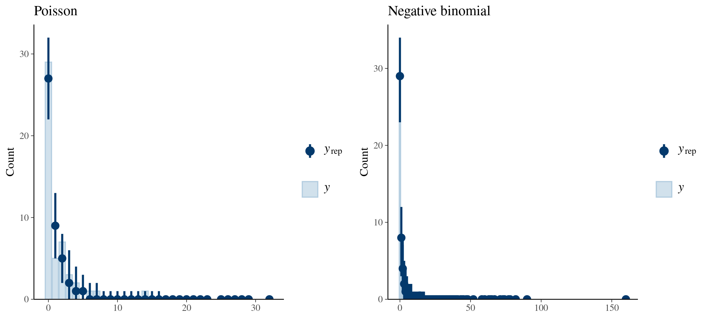
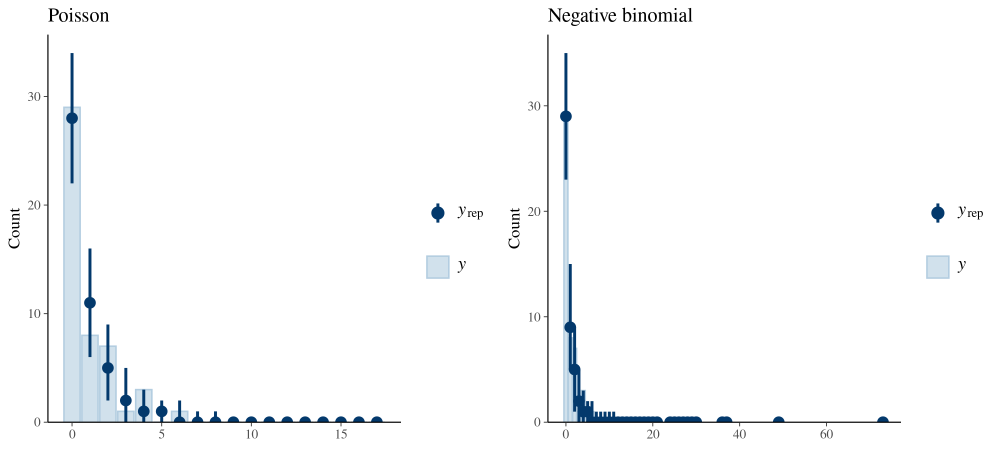

```{r setup, echo = FALSE, message = FALSE, warning = FALSE}

knitr::opts_knit$set(root.dir = "..")
knitr::opts_chunk$set(echo = FALSE, message = FALSE, warning = FALSE)

```

```{r load}

suppressPackageStartupMessages(library(brms))

d <- read.csv("data/raw/data_v2.csv", check.names = FALSE)
names(d) <- trimws(names(d))
d$year <- substr(d$FECHA, 7, 10)

lab <- c(
  GLCR = "Sympatric (*G. costaricanum*)",
  GLBR = "Allopatric (*G. brasilianum*)",
  GLEU = "Allopatric+ (*G. passerinum*)",
  BADE = "Control (*B. delattrii*)"
)

resp_lab <- c(
  INDIVIDUOS = "number of responding birds",
  MORFOESPECIE = "number of responding species and morphospecies"
)

fixef_table <- function(file, caption) {
  s <- summary(readRDS(file))
  r <- rbind(s$fixed, s$random$site)
  r <- r[, c("Estimate", "l-95% CI", "u-95% CI", "Rhat", "Bulk_ESS", "Tail_ESS")]
  rownames(r)[rownames(r) == "Intercept1"] <- "sd(Intercept)"
  r$Bulk_ESS <- round(r$Bulk_ESS)
  r$Tail_ESS <- round(r$Tail_ESS)
  knitr::kable(r, digits = 3, caption = caption,
               col.names = c("Estimate", "l-95% CrI", "u-95% CrI", "R-hat", "Bulk ESS", "Tail ESS"))
}

contrast_table <- function(file, caption) {
  x <- read.csv(file)
  x <- x[, c("contrast", "estimate", "lower.HPD", "upper.HPD")]
  x$contrast <- gsub("\\((Allopatric\\+)\\)", "\\1", x$contrast)
  credible <- sign(x$lower.HPD) == sign(x$upper.HPD)
  x$contrast <- ifelse(credible, paste0("**", x$contrast, "**"), x$contrast)
  knitr::kable(x, digits = 3, caption = caption, row.names = FALSE,
               col.names = c("Contrast", "Estimate", "95% HPD lower", "95% HPD upper"))
}

```

# Responsive taxa

```{r s1}

s1 <- read.csv("data/raw/responsive_taxa.csv", check.names = FALSE)
knitr::kable(s1, caption = "Table S1. Bird taxa exhibiting mobbing responses to playback of owl calls and control at Las Cruces Biological Station, San Vito, Costa Rica. Responsive taxa are confirmed species or morphospecies grouped by family.",
             col.names = c("Stimulus species", "Family", "Scientific / common name", "N° of individuals"))

```

# Sampling design

```{r sm2}

tab <- do.call(rbind, lapply(names(lab), function(s) {
  n24 <- sum(d$ESTIMULO == s & d$year == "2024")
  n26 <- sum(d$ESTIMULO == s & d$year == "2026")
  data.frame(Stimulus = lab[s], a = n24, b = n26 / 2, c = n26 / 2, Total = n24 + n26)
}))

knitr::kable(tab, row.names = FALSE,
             caption = "Table S2. Number of playback trials per stimulus, year and exemplar (recording of a different individual). All 2024 trials used exemplar 1.",
             col.names = c("Stimulus", "2024 (exemplar 1)", "2026 (exemplar 2)", "2026 (exemplar 3)", "Total"))

team <- ifelse(d$EQUIPO == 3, 2, d$EQUIPO)
site_n <- table(table(paste0("T", team, "_P", d$PUNTO)))

```

Sites received one (`r site_n[["1"]]` sites), two (`r site_n[["2"]]` sites) or four (`r site_n[["4"]]` sites) trials, always on different days (`r nrow(d)` trials at `r sum(site_n)` sites).

# Parameter estimates

Models include stimulus and year as fixed effects and site as a random intercept. Reference levels: sympatric stimulus, 2024.

```{r sm3-fixef, results = "asis"}

k <- 3
for (r in names(resp_lab)) {
  fams <- c(pois = "Poisson", nb = "negative binomial")
  for (fm in names(fams)) {
    fam <- fams[[fm]]
    print(fixef_table(
      file.path("data/processed/models", paste0(r, "_", fm, ".rds")),
      sprintf("Table S%d. Parameter estimates of the %s model of the %s.", k, fam, resp_lab[r])
    ))
    cat("\n\n")
    k <- k + 1
  }
}

```

# Pairwise contrasts and prior sensitivity

Contrasts are on the log scale; contrasts whose 95% HPD interval excludes zero are shown in bold.

```{r sm3-contrasts, results = "asis"}

specs <- list(
  c("pois_prior2", "Poisson model, normal(0, 2) priors"),
  c("pois", "Poisson model, normal(0, 6) priors (main text)"),
  c("pois_prior10", "Poisson model, normal(0, 10) priors"),
  c("nb", "negative binomial model, normal(0, 6) priors")
)

for (r in names(resp_lab)) {
  for (p in specs) {
    print(contrast_table(
      file.path("output/reanalysis", sprintf("contrasts_%s_%s.csv", r, p[1])),
      sprintf("Table S%d. Pairwise contrasts for the %s: %s.", k, resp_lab[r], p[2])
    ))
    cat("\n\n")
    k <- k + 1
  }
}

```

# MCMC diagnostics and posterior predictive checks









::: {.callout-note collapse="true"}
## Session information {.unnumbered .unlisted}

```{r session info}
#| echo: false

# if devtools is installed use devtools::session_info()
if (requireNamespace("devtools", quietly = TRUE)) {
  devtools::session_info()
} else {
  sessionInfo()
}
```
:::
